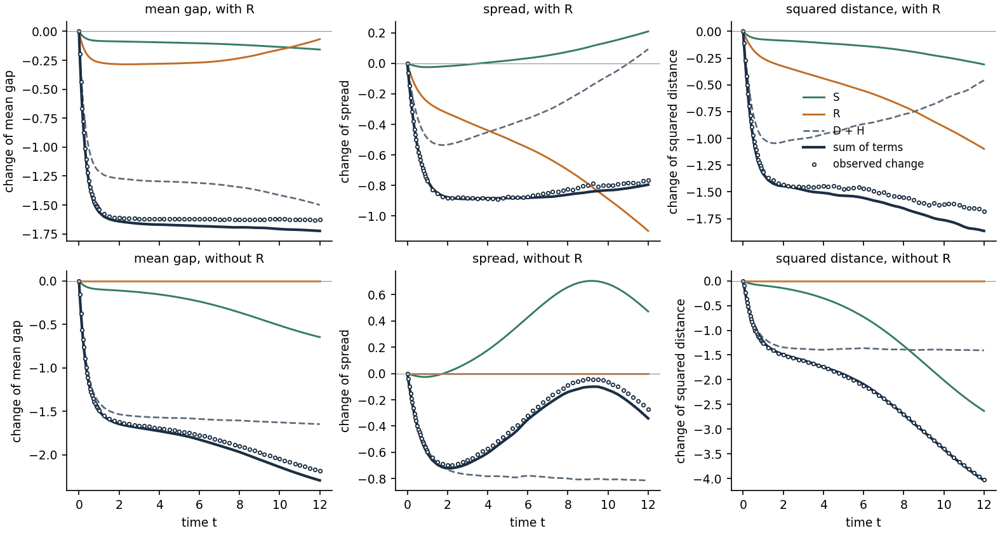
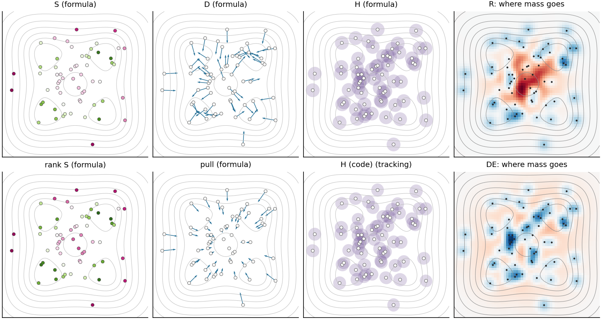

# Guide: the evolution equation, term by term

The other guides look at one step of an algorithm. This one looks at the whole
evolution of the population that the operators drive: how it moves, which operator is
responsible for which change, and what kind of contribution each operator makes. The
worked examples are [Tutorial 7](../tutorials/07_the_evolution_equation.py) (one and two
dimensions), [Tutorial 8](../tutorials/08_watching_a_population_evolve.py) (many
dimensions) and [Tutorial 9](../tutorials/09_operator_fingerprints.py) (operators).

## The equation

When the step size is small, an assembly moves its population along the solution of an
**evolution equation**: the rate of change of the population average of any smooth
function `phi` is the sum of the operators' effects on it,

```
d/dt <phi, mu_t> = G_1[mu_t](phi) + G_2[mu_t](phi) + ... + G_J[mu_t](phi).
```

`G_j[mu](phi)` is the generator action of operator `j` (its "effect" in the other
guides), and the sum is the composition theorem of the paper. Each operator contributes
one **term**. For the canonical operators the equation is the transport-reaction-jump
equation of the paper,

```
d/dt mu = -div(b mu) + (sigma^2/2) Lap mu - omega (Phi - mean Phi) mu + gamma (R[mu] - mu),
```

and the terms come in four kinds:

| kind | effect on a test function | what it does | canonical example |
|---|---|---|---|
| reaction | `-omega Cov(Phi, phi)` | reweights individuals where they are; creates no new points | selection |
| transport | `E[grad phi . b]` | moves individuals continuously | drift |
| diffusion | `(sigma^2/2) E[Lap phi]` | spreads individuals by small random steps | Gaussian noise |
| jump | `gamma (E[phi(child)] - E[phi])` | replaces individuals by new ones, possibly far away | recombination |

The equation holds for every test function, and choosing the test functions is choosing
what to look at.

## Step 1: follow the equation

```python
from evoscope import evolution
flow = evolution.flow(assembly, initial_population, tau=.02, t_end=10., rng=rng, size=4000)
flow.times, flow.populations          # recorded times and populations
```

`flow` applies the operators to many weighted particles with a small step (the cost of a
step is linear in the number of particles). With many particles and a small step the
populations approximate the solution of the equation. With few particles they do what
an algorithm does: `size=N, resample=1` resamples to equal weights in every step, and
runs scatter around the solution ([Tutorial 7](../tutorials/07_the_evolution_equation.py)).

In one dimension, `evolution.TRJ1D(assembly, grid)` solves the equation itself on a grid,
term by term; it reads drift, noise, selection rate and recombination from the
operators.

## Step 2: choose a view

A **view** is a family of test functions evaluated together. `evolution.term_rates(assembly,
population, view)` returns every operator's term through the view.

| view | shows | dimension |
|---|---|---|
| `summary_view(f, pop, target=None)` | mean gap, spread, squared distance to a minimizer | any |
| `level_view(f, levels)` | share of the population with gap at most `c`, for each level `c` | any |
| `spread_view(pop)` | total spread and the variances along the principal axes | any |
| `mean_view(d)` | the mean | any |
| `density_view(grid, bandwidth, directions)` | smoothed density along one or two directions | projections |
| `View(value, labels, gradient, laplacian)` | your own family | any |

Views centred at the current population (`spread_view`, `summary_view`) are rebuilt at
every time; pass them to the ledger as a function of the population.

## Step 3: keep a ledger

```python
ledger = evolution.ledger(assembly, flow, lambda pop: evolution.summary_view(f, pop))
viz.plot_ledger(ledger, index=0, groups={"D + H": ("D", "H")})
```

The ledger records each operator's term along the flow (`rates`) and its time integral
(`contributions`): how much of the change of each quantity the operator is responsible
for. The integrals add up to the observed change (`change`); this is the definition of a
solution of the equation. Along a particle flow a small difference remains, from the
finite number of particles and the finite step. Two large terms that nearly cancel (drift
and noise at the bottom of a well, typically) are best shown together with `groups`.



For the objective values, `viz.plot_levels` shows the share below every level over time
and `viz.plot_level_terms` which operator moves mass across which level. Per-capita rates
(terms divided by the viewed share) tell whether a part of the population grows, and
because of which operator ([Tutorial 8](../tutorials/08_watching_a_population_evolve.py)).

## Step 4: read off the kind of term of an operator

```python
chars = evolution.local_characteristics(op, population)       # growth, drift, diffusion per individual
viz.plot_characteristics(chars)                                # portrait in two dimensions
prints = evolution.fingerprint([op1, op2], population, objective=f)
print(evolution.format_fingerprint(prints))                    # sizes of the four kinds, and effects
```

Near an individual, every term acts through a **growth rate** (reaction), a **drift**
(transport) and a **diffusion matrix** (diffusion), plus the mass it brings from
elsewhere (jumps): the local characteristics of the term. For canonical operators they
come from the formulas. For an operator given as code that moves each individual, they
are estimated from repeated small steps (mean and mean square of the displacements);
`innovation_rate` measures how much mass an operator places away from the whole
population. A heavy-tailed mutation (a Levy flight) is recognized as a jump, not a
diffusion.



## What the kind of a term implies

The kind fixes the form of the term, and with it some effects that hold on every
population.

* **Reaction** with a rate that increases with the objective (selection by value or by
  rank) never lowers the share of the population below any objective level, and so never
  raises the mean gap. Reason: the term is minus a covariance between an increasing and a
  decreasing function of the objective value, which is never positive. Its size is at
  most `omega sd(Phi) sd(phi)`: selection fades as the population's objective values
  agree. On a Gaussian population with covariance `Sigma` it moves the mean by
  `-omega Sigma E[grad Phi]` and the covariance by `-omega Sigma E[Hess Phi] Sigma` (Stein's
  lemma): a smoothed gradient step preconditioned by the population's covariance.
* **Transport** along a descent direction never raises the mean gap. Linear drifts
  `b(x) = -kappa A x` change the covariance by `-kappa (A Sigma + Sigma A)` exactly.
* **Diffusion** leaves the mean unchanged, adds `sigma^2` to the variance in every
  direction, and never lowers the mean of a convex function.
* **Jumps** to blends `(1 - xi) x + xi y` of independent parents (`0 <= xi <= 1`) keep the
  mean; the children's covariance is the parents' times `1 - 2 E[xi (1 - xi)]` (one half
  for midpoints), and the term never raises the mean of a convex function (Jensen's
  inequality). On a
  non-convex objective they can: the child of parents near different minima lands
  between them. Jumps are the only kind that place mass far from the current population
  at once.

When the terms of a moment depend only on that moment (linear drift, noise and blends,
for the covariance), they give a closed equation whose equilibrium is where the terms
balance; selection adds a term that is exact for Gaussian populations
([Tutorial 9](../tutorials/09_operator_fingerprints.py)).

## What the results mean

* Flows with many particles approximate the solution of the equation; they are not runs
  of your algorithm with its population size. Finite populations fluctuate around the
  solution, and for multimodal problems the fluctuations can decide the outcome.
* Terms are computed by formula where one is known and estimated from small steps
  otherwise. Estimated terms carry sampling noise, which is largest for terms built from
  second derivatives (diffusion seen through narrow test functions).
* The sign rules above are exact for the canonical forms named; for other operators the
  fingerprint tells which kind of term they contribute on the populations examined, which
  is evidence, not proof.
